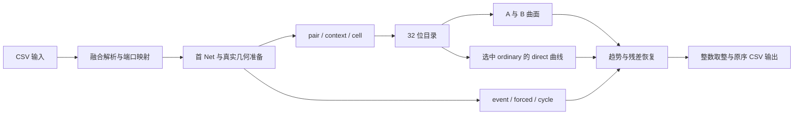

# EAT243 实际发布架构与逐字节账本

本章以不可变版本的实际源码为准。[worker.cpp](evidence/formal243/source/src/worker.cpp)定义查询过程，[native_representation212.h](evidence/formal243/source/include/native_representation212.h)定义当前资产恢复与数组，[exp707_prepare_metadata.h](evidence/formal243/source/include/exp707_prepare_metadata.h)定义固定架构元数据。源码中的 `212`、`779`、`806` 是继承的技术编号，当前版本身份由包清单确定。

## 1. 冻结身份

| 对象 | 身份 |
| --- | --- |
| 版本 | `exp853-eat243-lossless-directory-20261104` |
| 来源私有提交 | `e0a7a86aaec8b0939974c90456eb36439a63d6e4` |
| 33 编译输入 canonical SHA | `c799b57b0a4b88d9ea61fb8c5af0623655238236108fc34ac1bec3f2cfc4d3f8` |
| ELF 字节数 | 86,937,624 |
| ELF SHA-256 | `69df6c6c0f8cb119e742b2662c609997be9f381681090dca1751ed4a97868c02` |
| 5 个生成资产总量 | 79,398,908 B |
| 工具链 | GCC 11.4.0，Ubuntu22.04匹配静态运行库，GNU ld2.38，静态libzstd |
| 本次核对 | 根`estimate`和版本`bin-estimate`完整SHA、大小相同 |

正式重建入口见 [REPRODUCE](evidence/formal243/REPRODUCE.md)，其准确参数来自 [build-report](evidence/formal243/evidence/build-report.json)。审计包为阅读资料，未复制79,398,908 B生成资产、86,937,624 B ELF或静态库；在原工作区用完整不可变版本重建。

## 2. 在线数据流



编译期将批大小固定为 **64**。每批依次执行 prepare、stage/prefetch、finish、write。输出保存输入端点原文与顺序。查询期间通过既有分配计数要求 `allocations==0`。

普通请求的索引取实际源角色 $s\in[0,207]$、目标角色 $t\in[0,287]$，以及经过首 Net 语义准备后的名义位移 $dx,dy$。具体坐标修正依 `first707` 和 `sd.dx/sd.dy`，不能把代码里的名义位移一律替换成未经准备的原始坐标差。

$$
\begin{aligned}
pair &=288s+t,\\
d &=2[dx<0]+[dy<0],\\
r_x&=|dx|\bmod10,\quad r_y=|dy|\bmod12,\\
context&=(10d+r_x)12+r_y,\\
q_x&=\lfloor|dx|/10\rfloor,\quad q_y=\lfloor|dy|/12\rfloor,\\
cell&=46q_x+q_y,\\
key&=480\,pair+context.
\end{aligned}
$$

实现要求 $|dx|\le119,\ |dy|\le549$，所以 $q_x\in[0,11]$、$q_y\in[0,45]$、$context\in[0,479]$、$cell\in[0,551]$。该索引是固定120×550架构的专门化，跨架构需重新构造与验收。

普通目录word的解码为

$$
c=word\mathbin{\&}1023,\quad
a=(word\gg10)\mathbin{\&}4095,\quad
b=word\gg22.
$$

恢复时实际保证 $c\le1011,\ a<2048,\ b<256$，曲面值

$$
r=c-67+A[d,a,cell]+B[d,b,cell].
$$

bit31为direct标记。命中且ordinary时，低位给出row，读取 $r=D[row,cell]$。命中但属于event/cycle时，取 `direct_old_words[row]` 恢复原A/B路径。

最终数值路径为

$$
\begin{aligned}
n&=\max(0,r+125q_x+(125[dy<0]+127[dy\ge0])q_y),\\
base&=n+fee,\\
\hat d&=\left\lfloor\max(0,base+raw)+0.5\right\rfloor+mandatory.
\end{aligned}
$$

需要非空cycle时用预计算cycle覆盖 $n$。`fee`、`mandatory`及首Net/Line的计算保留真实架构语义；它们属于语义分解，不能全部视为拟合补丁。

EAT117起，event0的ordinary分支 `raw=0`。event1/2使用`replacement679`；event1再增加`kForcedBias[context*4+floor(qx/3)]`。其中 $qx\le11$ 已由几何域检查保证。偏置表含 **480×4=1920 个 int8**，内容来自开发split0至7的forced样本，至少20支持，用`median(needed-raw)`构造。

```text
initialize:
    restore directory and A/B codebooks
    restore direct curves and keys
    for each direct key:
        remember old directory word
        overwrite directory word with marker | direct_row
    load embedded architecture
    validate fixed metadata and port ranges

for each batch of at most 64 rows:
    parse original endpoint strings
    prepare first-Net, geometry, fee, mandatory, event, cycle
    for each prepared row:
        read directory word
        prefetch direct curve or A/B values
    for each prepared row:
        evaluate surface, trend, event correction and rounding
    emit rows in their original order
```

异常请求的检查、不可达返回和特殊CLI分支仍以源码为准。上述伪代码只展开主域计算。

## 3. 静态存储与运行数组

| 资产 | 逻辑布局及展开 | 逻辑 B | 存储 B | 原始/压缩 |
| --- | --- | ---- | ---- | ---- |
| directory212 | $208×288×480×(2+2+1)$ | 143,769,600 | 76,014,929 | 1.891334 |
| first212 | $4×2048×552×2$ | 9,043,968 | 876,616 | 10.316910 |
| second212 | $4×256×552×2$ | 1,130,496 | 70,574 | 16.018590 |
| direct_exact | $33,280×552×2$ | 36,741,120 | 2,303,669 | 15.948958 |
| direct_keys | $33,280×4$ | 133,120 | 133,120 | 1 |
| 合计 | 各项相加 | **190,818,304** | **79,398,908** | **2.403286** |

directory212的5字节记录是**压缩前的平面编码**。运行时把三个字段合成uint32，常驻目录为

$$
B_{\rm records}
=208\times288\times480\times4
=115,015,680\ {\rm B}.
$$

恢复一次只处理一个源，共 $288×480=138,240$ 条记录。临时五平面缓冲为

$$
B_{\rm planes}=138,240\times5=691,200\ {\rm B}.
$$

当前六个显式数组合计

$$
\begin{aligned}
B_{\rm arrays}
&=115,015,680+9,043,968+1,130,496\\
&\quad+36,741,120+133,120+691,200\\
&=\mathbf{162,755,584\ B}.
\end{aligned}
$$

六个数组各有`alignas(64)`。它们的长度都为64的倍数；若以各自独立起始地址计对齐，最坏额外间隙不超过 $6×63=378$ B。链接器的完整段布局还包含其他符号，这个378 B只针对六次起始对齐。

帧表共208项，每项3个unsigned。按本目标ABI的4字节unsigned、4字节对齐，stride为12 B，

$$
B_{\rm frame\_index}=208\times12=2,496\ {\rm B}.
$$

`Prepared596`按当前x86-64字段布局推导为56 B，其中4个unsigned、1个word、5个int共40 B，double使其到48 B，3个bool到51 B，末尾补至8字节对齐56 B。批64为 **3,584 B**；另有64个答案int为 **256 B**、64个string_view通常为 **1,024 B**。string_view尺寸依C++ ABI；这些是局部布局推导，实际RSS以进程测量为准。

将资产总量从ELF扣除只得到一个可核验余项

$$
B_{\rm ELF}-B_{\rm assets}
=86,937,624-79,398,908
=7,538,716\ {\rm B}.
$$

该余项包括代码、嵌入架构、模型、静态库、段头和对齐等。本次未逐section做归因，故不把余项任意分摊。

## 4. 五平面与差分为何“无损”

每源帧先解压为5个字节平面

```text
c = plane0[i] | (plane1[i] << 8)
a = plane2[i] | (plane3[i] << 8)
b = plane4[i]
if frame.delta and i % 12 != 0:
    c = (c + previous_c) & 65535
    a = (a + previous_a) & 65535
    b = (b + previous_b) & 255
check c <= 1011, a < 2048, b < 256
word = c | (a << 10) | (b << 22)
```

差分每12项重新起算，对应连续ry段。模 $2^{16}$ 或 $2^8$ 的加减互为逆运算；逐字段恢复、长度检查和范围检查为该变换的正确性条件。word将c置于bit0至9，a实际使用bit10至20，b置于bit22至29；bit21、bit30在普通word中保留为0，bit31留给direct。

若只按字段范围紧密打包，理论固定宽度为 $10+11+8=29$ 位，每目录需要

$$
\left\lceil28,753,920\times29/8\right\rceil
=104,232,960\ {\rm B}.
$$

与32位运行目录差 **10,782,720 B**，但仅29位流仍超过100 MB **4,232,960 B**，且未计其他资产。这个计算仅比较固定字段打包，压缩后字节和随机访问CPU均未知，不能从29位直接推导替代方案会更快。

本项目对解压长度、字段范围及恢复身份另有核验。这里的无损结论依据发布包的恢复代码、资产身份和等价收据，具体压缩比依据实际资产字节数。

**信息损失发生在曲面/修正预测与真实最短路之间。** EAT243保留原码字的无损恢复，不会消除先前A/B曲面近似造成的误差。

## 5. direct 曲线的容量与覆盖

33,280 个key占全目录的

$$
\frac{33,280}{208\times288\times480}\times100
=0.11574074074074073\%.
$$

这是**键空间占比**。请求分布非均匀，无法据此计算真实命中比例。

若新增 $K$ 个direct键、每曲线552个int16，同时保存4字节key和4字节旧word，则新增逻辑数据约

$$
B_{\rm direct,run}(K)=K(552\times2+4)
=1108K,
$$

其中key静态流若另映射常驻，还需计入最多 $4K$ B对应页；当前key读取后没有单独动态key数组。静态新增量为

$$
B_{\rm direct,static}(K)
=B_{\rm compressed\ curves}(K)+4K+B_{\rm metadata}+B_{\rm alignment}.
$$

现有direct曲线压缩比约15.948958不能保证新增曲线具有同一压缩比。保留当前结构时，K增长的字节项可直接计算，压缩比、请求命中权重和CPU效应需实测。

## 6. 当前 1B 计时、RSS与准入外推

[正式summary](evidence/formal243/evidence/summary.json)以A=176、B=243，A/B各预热一次后执行ABBA、BAAB、ABBA，计时每臂6次。候选均值分解

$$
97.67589283333334_{\rm user}
+27.533046166666665_{\rm sys}
=125.208939_{\rm CPU}\ {\rm s}.
$$

三个区组的CPU节省分别为 **2.974073、3.5776285、3.640496 s**。样本量是3个登记区组，97.5%单侧CPU节省下界 **2.4833449629670152 s**，除以120得到 **0.02069454135805846** 的联合综合分下界。该推断依赖当前区组与机器状态。

候选7次完整运行的RSS最高 **295,555,072 B**，父版7次最高 **309,907,456 B**。两者差 **14,352,384 B**。候选本地AMD完整1M门测到 **295,784,448 B**，相同ELF跨环境测量会有差异。当前六数组之和162,755,584 B没有覆盖全部RSS；两者差 **132,799,488 B**只代表未逐项分解的其余驻留页。

CPU准入收据中的同ELF r9完整1M为 **0.52224 s**，100M为 **10.625620000000001 s**。按仿射模型 $T(n)=a+bn$，以百万请求为单位，

$$
\begin{aligned}
a&=\max\left(0,\frac{100T_1-T_{100}}{99}\right)
=0.42018565656565665,\\
\widehat T_{1000}
&=a+10(T_{100}-a)
=102.4745290909091\ {\rm s}.
\end{aligned}
$$

实测比该外推高 **22.7344099090909 s，22.1854251108%**。因此这一模型承担“预计≤200 s才准入”的筛选作用；1B成绩仍为125.208939 s。100 s目标若按当前均值计算，还需降低 **20.1334978168%**。

实际发布ELF另在本地AMD/WSL以空环境、清洁cwd执行完整1M，CPU **0.96 s**、wall **0.984233266 s**，契约通过，Acc复用为 **98.8752701109582%**。其文件系统namespace仍可见，`official_consecutive_five_verified=false`。这组数据属于交付工程门，不能替代r9性能或官方平台证据。详见 [full1m](evidence/formal243/evidence/full1m.json)和 [cpu-admission](evidence/formal243/evidence/cpu-admission.json)。
