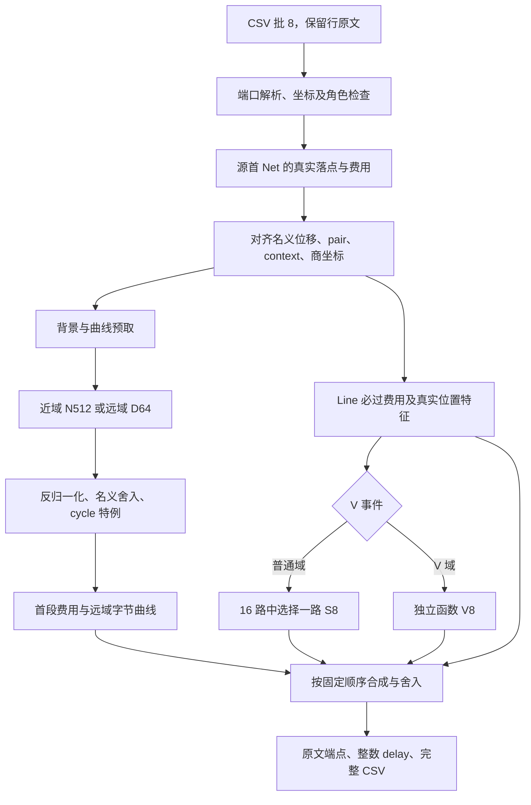
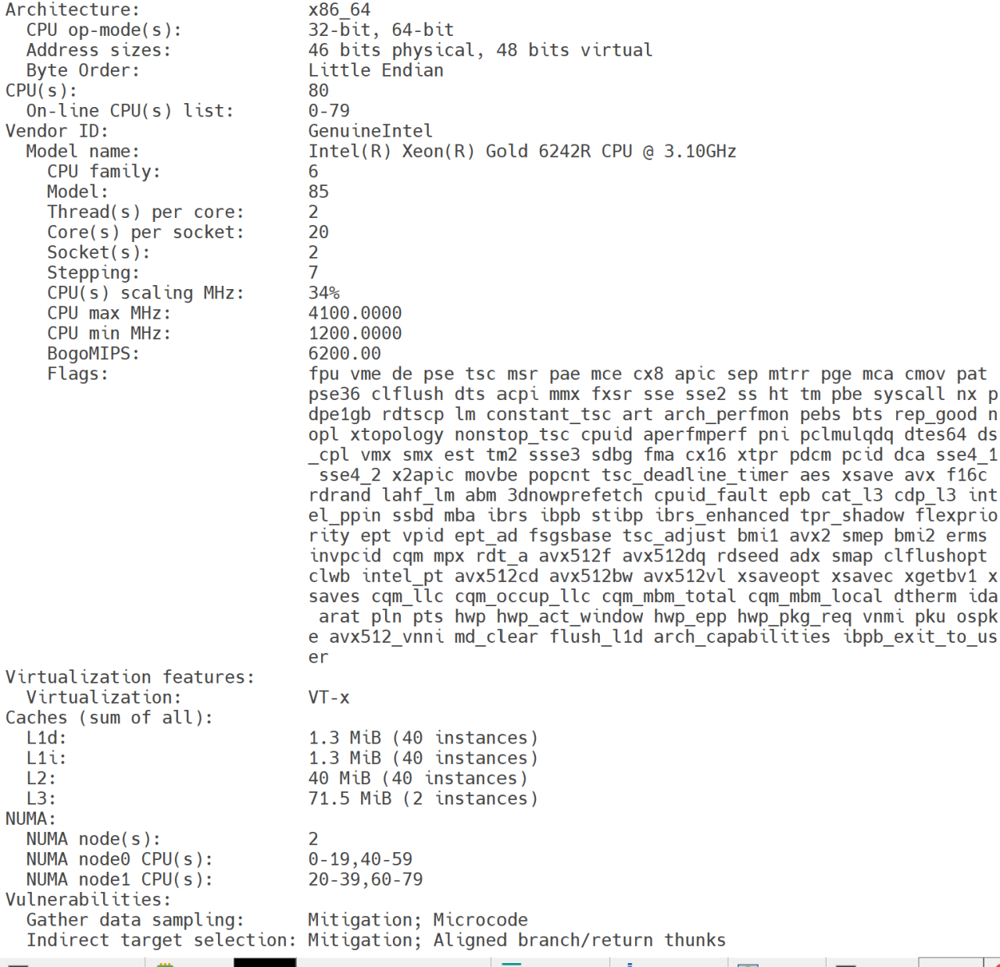

# exp688 外部 AI 提问书

我们正在开发 FPGA SRB 布局布线延时估算程序，希望你从图算法、结构化近似、统计验证和 CPU 工程实现四个方面，独立审查当前方案。

**近期目标是在事先未知、完整请求对全部非重复的 10 亿条请求上，同时达到总体 Acc 严格大于 99%、完整程序 CPU 时间约 100 秒。后续目标是 Acc >99.1%、CPU <90 秒。** 两项成绩必须来自同一制品、同次完整运行的输出。我们希望在 Intel Xeon Gold 6242R 上高度优化，同时保留主流 Intel、AMD x86-64 CPU 可运行、可自动选择适合加速实现的版本。

本次分析对象固定为 **exp688 提交包对应源码**。它在 r9 Xeon 上的完整非重复 1B 实测为 CPU **243.302538 秒**，同次输出的 **3,833,856 条 exact 分层样本**估计 Acc 为 **98.658061657%**。后续研究已到 exp706，其中部分机制诊断和 100M 加速结果已经完成，本文一并提供，供你计算建议的新增价值。

我们目前最看好的方向有两项。

- 精度方面，从真实位置下的路径合法性、最终落点和端口支持条件中寻找便宜的小状态，用它改善或替换现有背景与地图残差的部分表示。
- CPU 方面，利用架构固定这一条件，把更多查询准备离线编译为紧凑状态，减少在线几何计算和依赖访存，再结合批处理与合适的指令实现。

以上是有历史证据支持的**研究假设**。请先独立判断其可行性，再回答第六至第九节的四组问题。若你发现更有希望的方向，请给出相应证据与替代方案。当前研究暂停，本次咨询用于决定接下来的实验顺序。

代码与记录仓库为 `https://github.com/Lijika/faga_delay_estimate`。本文整理时的源码发布提交为 `333d433bcb3c71667c89b3cc6b1ef2ce0f32f0d6`，`source/` 对应下文冻结制品。仓库中的后续文档更新不会改变这个源码身份。阅读入口和原始证据见第十一节。

## 一、赛题与真实图语义

### 1.1 要求估计什么

赛题一由紫光同创提供，任务是在固定 FPGA 互连阵列中，给定两个完整 pin，估计所有合法有向路径中的最小延时，单位为 ps。每条请求独立求值，目标函数是固定图上的最短路径延时。输入形式为 `SRB_<x>_<y>/<Port>`。

图中的状态同时包含坐标和完整端口。SRB 内部通过有向 Arc 连接端口，SRB 之间通过 Net 连接。端口的方向、类型及 lane 会限制可接续的动作。只保留二维坐标会丢失图的状态。

五份官方 JSON 共同描述**同一个架构**。对当前冻结文件的计数如下，依据为 `source/arch/`。

| 文件 | 当前内容 | 算法必须保留的含义 |
| --- | --- | --- |
| `SRB_Inst.json` | 外接范围 120×550，实际存在 60,200 个 SRB | 坐标范围内仍有缺格 |
| `SRB_Port.json` | 496 个端口名称 | 完整端口和 lane 是状态的一部分 |
| `SRB_Arc.json` | 8,192 条内部 Arc 模板 | 有向连接及各自整数延时 |
| `SRB_Net.json` | 160 条跨格 Net 模板 | 名义位移和目标端口 |
| `SRB_Gap.json` | 7 个 Block、5 条水平 Line、15 条垂直 Line | 合法落点、跳格和额外费用 |

Net 的名义轴向步长包括水平的 1、2、4、10 和垂直的 1、2、4、12，各有正负方向。沿指定轴推进时，可横穿 Block 的格点不消耗名义步数，因而真实落点可能超出普通坐标相加的结果。当前六个中央 Block 位于 `x=76..89`、`y=100j..100j+49`，`j=0..5`，横向可穿、纵向不可穿，横穿费用为 292 ps。另有左下方 `x=0..15,y=0..99` 的 Block。精确推进规则以 `Architecture::resolveOffset` 和经核验的 `resolveNet` 为准。

Line 按实际跨过的边界收费。跨格后的落点必须是存在的 SRB；路径的每一步还必须满足端口连接关系。对缺格、不可横穿区域以及名义位移的解释，请回查官方说明和实现，避免套用普通平面障碍物上的无向几何距离。

### 1.2 当前模型覆盖的端点域

当前查询模型按 **208 个源角色端口 ×288 个目标角色端口**组织，共 **59,904 个完整端口对**。全端口测试中的“全端口”指这一角色域的全部组合。模型保留了各 lane。

这是当前实现与实测范围。赛题描述中的一般 From/To pin、其他合法端点组合、相同 pin 空路径、不可达请求和边界情况，需要逐项对照官方输入承诺及源码处理。请单独指出域外行为和潜在覆盖缺口。当前完整 1B 中不可达计数为零，这项观察支持的范围限于该输入。

### 1.3 标签与诊断对象

研究中的 `exact` 来自经独立核验的精确求解器，公开 golden 用于评分与图语义核对。精确求解、训练和统计评分属于离线研究，成本单列。

历史诊断还使用过无限名义图距离、移除 Line 收费后的真实距离 `D0`，以及真实最优路径的端口词。端口词是依次经过的端口和动作序列。它可以在另一位置按真实规则重放，检查合法性、终点和费用。以上对象服务机制分析，部署时实际可计算的信息需要另行证明。

## 二、全部交付约束与研究要求

### 2.1 平台和最终制品

下表区分规则来源。赛题 PDF 为 V0.3，日期为 2026-08-31；后续补充、平台实测和用户要求共同确定当前交付条件。

| 条件 | 必须遵守的要求 | 来源 |
| --- | --- | --- |
| 调用接口 | `estimate -in <request.csv> -out <result.csv>`；运行所需信息由这两个路径和程序自身提供 | 赛题 5.5、用户交付要求 |
| 单个程序 | 提交单个可执行文件；官方参考 ZIP 只含 `bin/` 和 `bin/estimate` | 赛题、官方参考包 |
| 自包含 | 五份架构 JSON、模型、字典及预计算数据全部嵌入 ELF；运行不依赖旁置数据、网络下载或额外输入路径 | 评测镜像实测、用户 |
| 静态链接 | 当前交付必须静态链接；平台为 Ubuntu 22.04、glibc 2.35、GLIBCXX_3.4.30，本机版本更高 | 平台兼容要求 |
| ELF 容量 | **严格小于 100,000,000 B**，采用十进制 100 MB；检查最终静态 ELF | 赛题后续追加硬约束 |
| 单线程 | 整个在线程序只使用一个线程，包括初始化、资产恢复、查询和读写 | 赛题 5.2 |
| 内存 | 峰值不超过 2 GB；本地工程验收采用 RSS ≤2,000,000,000 B | 赛题 5.2、工程标准 |
| 单次总时长 | 完整 1B 每次运行不超过 3,600 秒；五次中任一次超时或超内存会使作品无效、得零分 | 赛题 5.2 |
| 时间评分 | 评测执行五次，统计平均 CPU 时间；平均超过 1,800 秒，时间项为零 | 赛题 5.2 |
| 输出确定性 | 同一输入五次输出完全一致时一致性得 100 分；有差异时该项为零，Acc 取五次平均 | 赛题 5.3 |
| 输入格式 | CSV 表头 `From,To`，随后每行两个完整 pin | 官方接口、当前入口 |
| 输出格式 | 表头精确为 `From,To,delay`，小写 `delay`；端点原文、顺序、精确行数、三个字段、整数 delay、精确 EOF 全部满足契约 | 官方答案与平台、工程验收 |
| 通用 CPU | 一份 x86-64 ELF 自动识别可用能力；在非 6242R 的主流 Intel/AMD CPU 上保留通用路径和经过验收的加速路径 | 用户本轮要求 |
| 6242R 专门优化 | 同一程序在目标 CPU 上自动选择经实测合格的专门配置 | 用户本轮要求 |
| 最终精度 | 总体 Acc **严格大于 99%**；长期目标为 >99.1% | 用户要求 |
| 完整性能目标 | 本轮争取非重复 1B 约 100 秒，长期 <90 秒；历史 <200 秒为阶段记录 | 用户本轮要求 |

评测镜像只创建程序、输入、输出等工作目录，未提供架构或模型文件。旁置预计算文件是否会保留、运行目录如何设置，尚无平台验证。本次请按单文件静态自包含条件设计。

100 MB 这一条来自后续补充，V0.3 PDF 中没有记载。ZIP 压缩大小、恢复后的常驻内存和最终 ELF 文件大小需要分别核算。可以在启动时恢复嵌入资产，恢复时间计入完整程序 CPU，恢复期间的峰值内存也计入资源限制。

离线预计算与训练可以使用研究工具，但需要报告构造成本和重建方式。任何模型和表都应由固定架构、允许使用的开发数据及训练流程产生。未知评测请求的答案不能预先写入表。部署程序也不能依赖额外训练服务、GPU或并行辅助进程完成查询。

### 2.2 精度与综合评分

对正 exact 延迟 `g` 和整数预测 `p`，单点分与总体精度为

```text
point_score(p, g) = 1 - tanh(4 * abs(p - g) / g)
Acc = 100 * mean(point_score)

TotalScore = 0.80 * Acc + 0.15 * TimeScore + 0.05 * ConsistencyScore
TimeScore = 100 * max(0, 1 - avg_CPU_seconds / 1800)
```

这是连续的相对误差得分。精确命中率、MAE、相对误差和训练中的 SSE/L1 要分别记录。零延迟在本地评分器中按“预测也为零得满分，否则为零”处理；官方零值及不可达特例仍需核对评测实现，不能直接代入除法。评分和时间公式已回查 PDF 第 4、5 页图像。

在时间分仍为正且一致性相同的条件下，项目采用以下增量换算，`ΔAcc` 的单位为百分点，`ΔCPU` 的单位为完整 1B 的秒。

```text
delta_total_score = 0.8 * delta_Acc - delta_CPU / 120
extra_CPU_budget = 96 * delta_Acc
```

最终 99% 与时间目标仍须分别达到。综合分用于研究取舍，不能覆盖任何交付硬约束。

### 2.3 数据、泛化和验收

1. **后续完整程序测试只用非重复 100M →1B。** 旧 1M、10M 仅作为历史证据保留。小型局部数学检查、解析器枚举和资产审核可以服务机制验证，完整程序阶段成绩依据对应规模实测。
2. 100M 通过事先登记的收益与资源门后，及时接入阶段版，并完成**全端口、完整请求对非重复的 1B**。完整输出和精度采用同次运行结果。
3. 用户目标中的请求事先未知。完整 From/To 请求缓存按全 miss 评估；结构、端口、相位和几何状态的复用仍可研究。公开练习平台曾将 100 万公开样本随机复制至 10 亿，这一历史练习分布单独记录。
4. 同一架构上的新请求检验同架构泛化。跨架构结论另需证据。请求要覆盖端口对、源 pin/源族、lane、空间区域、方向、距离、近轴、边界和特殊事件，并安排多样化分布与行序。
5. 反复查看的请求归入开发集。模型、特征、阈值或路由选型后，使用未参与选择的新请求确认；按假设隔离 source-pin、端口族或空间区。背景、曲线、残差和路由的折外训练关系一起检查。
6. 100M 与 1B 均安排足够多的 exact 标签，报告抽样框、分层权重、样本数和区间。当前已有 100M 的 1,916,928 条及 1B 的 3,833,856 条分层 exact 证据可供参考；新增方案按所需精度决定扩样，不能仅凭少量标签宣称跨过 99%。
7. 精度采用配对比较。计时事先固定预热、交错顺序和次数，同机串行并避开重负载。报告效应和区间，事先写明最小实际收益、停止条件及多候选选择方式。
8. CPU 与 Acc 联合进入帕累托判断。研究可以接受精度暂降以验证速度机制，最终交付恢复到用户要求。宣称显著且有实际价值时，综合收益的 95% 下界为正，并达到预登记点估计门槛。
9. 当前局部比较冻结 exp688；项目长期 CPU 参照另保留 exp323，在匹配输入、硬件和配置下比较。原发布默认配置和匹配配置分别说明。
10. 本机 AMD 时间只作参考，主要性能比较在远端 Xeon，正式表现由比赛平台决定。截图目标机器、历史 r9 和官方平台分别标明身份。CPU、wall、RSS、线程数、输入唯一性、完整输出 SHA 与契约一起记录。

代码、输入、环境与输出身份相同时可复用已通过证据。exact、统计评分和输出审核的 CPU 成本单列。最终五次一致性需要相应证据；exp688 目前的一次完整 1B 记录只支持下文已测范围。

## 三、exp688 的冻结身份与目标差距

### 3.1 已测制品

| 项目 | exp688 实际记录 |
| --- | --- |
| 固定包标签 | `exp688-v8-boundary-generic-1b243s-1965119f-dirty-20261025-0035` |
| 实际查询代码 | exp686/N，通用 SSE2、批 8、D64 字节曲线、S8 与 V8 |
| 完整输入 | 1,000,000,000 个非重复请求，覆盖 59,904 个角色端口对 |
| CPU / wall | 243.302538 / 269.009493 秒 |
| 峰值 RSS / 线程数 | 206,372,864 B / 1 |
| 查询阶段堆分配 | 0 |
| 输入 / 输出大小 | 35,197,849,579 / 40,135,645,803 B |
| exact 评分范围 | 每端口对 64 条，共 3,833,856 条 |
| 人口加权 Acc | 98.658061657% |
| 保守 97.5% 区间 | [98.617937144%, 98.698729883%] |
| 相对 exp655 的同样本配对差 | +0.020594343 pp，保守区间 [0.019158850, 0.022113457] pp |
| 评分 CPU | 155.043237 秒，单列 |
| 静态 ELF | 93,402,392 B；距 100,000,000 B 还有 6,597,608 B |
| 提交 ZIP | 81,369,669 B |

制品身份如下。

```text
ELF SHA256
66fb0307d24b4ce2fa4514350e97420acf9de37171419f15c6001ac15dc985e3

ZIP SHA256
fb39a2476d0d2ea99d2cf6c29536a63383bfed0a8174505db1a5f8c601a5f94c

1B input SHA256
3e01ed8f591ca1c06e3e4c36e66853437b784efbff22d1cc9880d4baf1adc474

1B output SHA256
48341077a285b50acbaedd771419849550f141c569020b6eb9d4248a7e1754a9
```

`source/` 已在 r9 原工具链的独立目录重建，五份目标文件和最终 ELF 均与冻结包逐字节一致。工具链为 Ubuntu 22.04、GCC 11.4.0、binutils 2.38 和相应静态运行库。源码目录提供全部嵌入资产和构建脚本。

1B 只完整运行过一次，计时的配对统计另参考 100M 实验。该 1B 请求已被历史验证观察；抽样区间描述已测分布，源族重采样区间还反映组成敏感性。官方隐藏集成绩、全量 1B exact 精度及其他 CPU 表现仍待验证。

### 3.2 需要解释多大的改进

| 目标 | 从 exp688 点估计出发的差距 | 完整程序的平均预算 |
| --- | --- | --- |
| Acc >99%，CPU 约 100 秒 | 至少约 +0.341938343 pp；CPU 减少约 58.90%，约 2.43 倍速度 | 100 ns/请求，包含初始化、解析和输出的摊销 |
| Acc >99.1%，CPU <90 秒 | 超过 +0.441938343 pp；CPU 减少超过约 63.01%，超过约 2.70 倍速度 | 小于 90 ns/请求 |

仅作算术换算，若运行时实际频率稳定为 3.1 GHz，100 ns 对应 310 cycles，90 ns 对应 279 cycles；若为 4.1 GHz，则分别为 410 和 369 cycles。实际持续频率需要测量。

本次 1B 的输入与输出合计约 75.33 GB。请把扫描、复制、数字转换、系统调用及内核 CPU 都纳入预算，同时报告 wall 和存储条件。按 CPU 秒计算的字节处理需求与磁盘 wall 吞吐属于不同量，等待 I/O 的时间需要单独分析。

## 四、exp688 的算法架构

### 4.1 查询依赖关系



源坐标记为 `s`，目标为 `t`。若源端口有强制首 Net，名义首位移记为 `v`，真实落点记为 `a`；逻辑源取 `a=s,v=0`。背景使用的对齐名义位移为

```text
d = t - a + v
bx = abs(d.x)
by = abs(d.y)
qx = bx / 10                 # 整数除法
qy = by / 12
direction = 2 * (d.x < 0) + (d.y < 0)
context = (direction * 10 + bx % 10) * 12 + by % 12
pair = source_index * 288 + target_index
```

因此 context 共 `4×10×12=480` 个。模型近域为 `qx+qy<=3`，远域为其余情形。这个近远划分与其他历史统计中的距离桶需分别核对。

`prepare596` 解析首段、构造索引、发出预取，计算位置特征并执行 S8/V8。`finish596` 读取背景与曲线，再合成整数预测。批内先准备多条查询，再依次完成输出，为不相关请求提供访存重叠机会。批大小和准备结构的大小都有实际成本。

### 4.2 背景、曲线和舍入

近域 N512 使用 rank 512；远域 D64 按四方向组织，每次 rank 64。双方因子为 signed INT8，每 64 维一组，以整数点积乘左右 float32 scale，转换为 double 后按冻结顺序累加。近域有八组，远域一组。

以下为 `finish596` 的主要运算顺序，省略错误处理与索引细节。

```text
response = geometry(pair, context, qx, qy)
value = response * (128 + 125*qx + 125*qy)
        + center[pair] + 125*qx + (d.y < 0 ? 125 : 127)*qy
nominal = int(max(0, value) + 0.5)
nominal = cycle_value_if_required(nominal)
base = nominal + first_non_Line_fee + far_curve_correction
prediction = int(max(0, double(base) + tree_raw) + 0.5)
             + mandatory_Line_fee
```

`first_non_Line_fee` 从实际首 Net 费用中扣去该段 Line 费。必过 Line 项按 `s→a` 与 `a→t` 的坐标割收费构造。名义背景的近似值与完整合成值的上下界资格需要单独证明。

远域曲线先从 `pair×context` 字节目录取一个 code，再用方向、code 和二维商坐标读取共享曲线值，最后加固定原点 `-55`。近域的这项修正为零。曲线与低秩背景共同拟合名义响应，其误差还会影响真实地图残差学习。

数值等价优化需要保留整数点积、每块 scale 乘法、块间累加、树叶相加、两次舍入和 cycle 语义。当前构建使用 `-fno-fast-math -ffp-contract=off`。

### 4.3 地图修正

S8 按方向及两轴距离条件分为 16 路，每条请求只选择一路的八棵对称树。V8 为独立 `noinline` 专家函数。生产配置为 `EXP640_TREES=8`、`EXP684_V_ONLY`；归档模型中的 S16、V64 只取相应前八棵树，H 专家关闭。

V 事件要求首落点 `a` 和目标 `t` 的横坐标都在中央合法走廊 `76..89`，并且 `abs(a.y/100-t.y/100)>0`。普通特征中的 `forced` 则检查两端在同一 Block 纵区间内横向跨越的情形。两者有不同语义，后续优化需分别保留。

源码仍有用于历史审计的特征构造和条件编译分支。请以 `source/build.py` 的有效宏、生成代码和反汇编判断实际工作，特别检查编译器已经消去的表达式。

### 4.4 当前资源布局

| 资产 | 当前形状或字节数 | 对设计的影响 |
| --- | --- | --- |
| 近域左 INT8 因子 | 59,904×512，30,670,848 B | 近域分配了大量表示容量 |
| 近域右 INT8 因子 | 4,800×512，2,457,600 B | 480 context，每个十个近域商点 |
| 远域左 INT8 因子 | 4×59,904×64，15,335,424 B | 方向和 pair 决定行 |
| 远域右 INT8 因子 | 260,160×64，16,650,240 B | context 和商坐标决定行 |
| 几何资产整体 | 压缩 56,503,992 B，恢复 69,303,616 B | 包含因子、scale、中心值及头部 |
| 曲线目录 | 59,904×480，28,753,920 B | 每条远域请求一次随机 code 读取 |
| 曲线正文 | 4×256×542，555,008 B | 读取依赖前一步 code |
| 完整曲线资产 | 29,308,992 B | 另含 64 B 头部 |
| 完整 ELF / RSS | 93,402,392 /206,372,864 B | 静态容量、恢复布局、热工作集分别优化 |

正式 exp688 仅编译并选择通用 SSE2 worker，`EXP608_SIMD=0`。源码中的 SSE4.1、AVX2 分支保留了历史实现，本版本尚未启用 6242R 专门配置。

## 五、历史探索中哪些证据改变了判断

### 5.1 从 exp610 到当前的主要进展

以下每项都限定实际表示、训练域与部署配置。详细实验原文保存在 `experiment/`，整体复盘位于 `docs/research/exp610-701复盘与研究优先级.md`。

| 实验 | 主要结果 | 后续应如何使用 |
| --- | --- | --- |
| exp607 至 exp610 | SSE4.1、AVX2 实现数值等价；旧配置 AUTO 比整查询 SSE2 慢 0.018253 秒/10M，最终发布通用 SSE2 | 复用安全分派经验；当前 S8、曲线和 6242R 仍有独立评估价值 |
| exp611 至 exp621 | 部分秩分配与几何列收益有限，显式周期残量经 Q4 压缩保留约 +0.125 pp | 周期结构存在可利用信息；固定特征或秩分配的失败范围单列 |
| exp622 至 exp629 | 固定 R8 专门化 100M 省约 0.286 秒；全节点比较、更大批次和 Ring-8 的固定实现变慢 | 调度与布局受模型结构影响，旧结果不能直接决定当前 S8/V8 |
| exp640 至 exp644 | S8 结构使六对 100M 平均省 2.641978 秒，Acc -0.015695545 pp；1B 为 225.515516 秒 | 较大 CPU 收益来自结构变化；精度恢复有单独任务 |
| exp645 至 exp649 | SSE 目标改善未充分转成 L1；匹配 D96/Q4 约 +0.0823 pp，100M 增加约 1.375 秒 | 训练目标、背景补偿、访问成本需要联合检查 |
| exp650 至 exp655 | 二维共享曲线在新 100M 约 +0.191319140 pp；字节表示相对 int16 省 0.433186667 秒/100M；1B 为 243.434110 秒 | 条件表示带来主要精度进展，部署布局决定成本 |
| exp656 至 exp673 | 多种同预算重训、纯地图监督、角色分组、距离域更新得到小收益或局部退化 | 当前模型族与监督方式的限制仍需分开研究 |
| exp674 至 exp688 | 部分求值的若干配置收益弱；V8 约 +0.0206 pp；exp686 独立函数边界较原 V8 省 0.4418765 秒/100M | 低频事件分支也会改变公共路径的编译与栈成本 |
| exp687、exp689 | 完整响应离散目录的 15 bit 版本容量通过，固定低码数表示的留出质量明显退化 | 排除的是该表示和训练配置；其他连续/离散混合仍可讨论 |
| exp690 至 exp701 | 双 64 背景加匹配曲线，名义质量改善，真实 OOF 仅 +0.010353011 pp；ELF 94,295,320 B | 恢复与数值审核通过；增加约 16.3 MB 左工作集，完整 100M 尚未执行 |
| exp702、exp705 | 当前误差干预与固定名义键的位置配对，指向真实路径可实现条件 | 属于机制证据，在线模型和泛化收益待验 |
| exp703 至 exp706 | 查询准备和解析成为主要 CPU 研究对象；直接端口目录通过 100M 并进入阶段版 | exp706 的完整 1B 待测；本次供咨询源码保持 exp688 |

各历史 Acc 使用的样本和配置不同，跨版本收益应读取对应的同样本配对统计。表中的 1B 时间也各自受输入、硬件状态与计时次数限制。

### 5.2 当前 CPU 成本证据

exp703 对 exp688 完整 100M 做了画像，所有运行输出与冻结函数相同。无插桩运行 CPU 为 23.912229 秒，用户态采样共 23,697 个。部分归属如下。

| 项目 | 用户态样本比例 |
| --- | --- |
| `prepare596`，含内联工作 | 44.77% |
| `finish596`，含内联工作 | 18.79% |
| 解析 | 16.92% |
| S8 函数 `symmetric640` | 9.85% |
| 背景预取相关 | 11.01% |
| `resolveNet` | 4.29% |
| `dot64` | 3.58% |
| `memchr` | 6.29% |
| writer | 2.50% |

项目之间有内联包含关系，**这些比例不能相加**。采样落在某条源码语句上，也可能反映前面的访存停顿。这里采集的是用户态 cycles，系统态成本要另查。

同次实验的 `perf stat` 记录为 85,594,493,829 cycles、148,834,260,723 instructions，IPC 约 1.74，branch misses 685,433,271，cache misses 375,966,066。这是 100M 的测量，不足以直接建立 1B 或 6242R 上的性能上限。它使我们优先考虑准备过程、访问依赖和解析工作量，而纯点积加速的全程序影响需要另外估算。

exp704 将原 2048 槽端口探测改成 688 槽直接目录，覆盖全部 496 个名字，并通过 829,072 项解析对照。十四次完整 100M 的输出 SHA 一致。六对计时中，原版均值 23.789769 秒，候选 23.004201 秒，节省 0.785567833 秒，95% 区间为 [0.684196875, 0.886938791] 秒。exp706 已完成审核、清洁目录 100M 和阶段包，完整 1B 待测。这项加速应算作已有进展。

### 5.3 精度干预与真实位置的条件见证

exp702 在当前 V8 开发数据上，分别替换背景、地图和 Line 通道的 exact 标签，单项 Acc 干预量为 0.694561163、0.380144229、0.060875483 pp。它们依赖 oracle，彼此存在交互，不能相加成可部署收益。

其中 event=0、路径余量 S>0 且首 Net 后 Block 费用为零的 `ordinary_word` 组有 228,716 行，地图干预的全局贡献为 0.245858668 pp，源族组成敏感性区间为 [0.230519637, 0.261650779] pp。这里 S 表示真实最优端口词的 Arc 费用，相对于相同净名义位移的名义最优词费用所多出的部分。最优词的 tie 选择会影响该分解，S 也需要离线最优路径才能得到。

百万开发缓存中，重复完整 pair 和对齐名义位移的键仅 59 组。因此 exp705 专门固定完整 pair 与 `d=t-a+v`，每个 pair 选择四个真实位置，总计 239,616 条请求。59,904 个旧锚点复核，新增 179,712 条 exact D0，标签 CPU 为 629.036221 秒。

- 四位置中，32,781 个 pair 的扣首 Net 费用发生变化，11,255 个 pair 的范围至少为 20 ps。
- 把较便宜位置的最优词移植到较贵位置，共 127,013 次见证，其中 24,000 次出界，37,087 次落入缺格，65,601 次最终端点改变，325 次合法到达同终点但费用改变。
- 终点改变的见证全部为横向偏移 ±14、纵向偏移零。在两位置均 event=0、各自最优词首 Net 后 Block 费用为零的组内，仍有 58,484 次终点改变。这个组未额外施加 S>0，需与 exp702 的 `ordinary_word` 分组区分。
- 去掉目标位置自己的 oracle 词，仅使用其余三个位置的词，覆盖 192,072/239,616 个目标，其中 179,752 个恢复 exact D0。这是有限 oracle 候选的重放诊断，在线选词成本和未知位置泛化待验。

我们的解释是，真实位置会改变某个端口词能否合法执行并到达指定端点。原位置上的最优词无额外 Block 费，仍可能在别的位置发生跳格、到错终点，导致新位置选择另一条词。由此，费用统计和路径支持条件值得分别表示。有限词、四位置和 tie 选择限定了这些见证的范围。

## 六、问题一 审查我们最看好的方向，并回答关键难题

### 6.1 我们建议先尝试的方案

**精度主线是条件状态的重构。** 固定 pair、方向、余类与名义位移后，先利用多位置差分和路径交叉重放，识别会改变端口词支持的条件。候选信息包括首尾可接续端口、边界距离、缺格区、跳格导致的净横向位移及可部署的局部支持谓词。我们希望筛出少量有解释力的条件，用于选择背景子空间、曲线或残差，使一次查询保持小而固定的计算量。

接入当前方案时，可以先在冻结 exp688 上只改变一个条件模块，检查它对最终 Acc 的贡献；随后比较冻结残差与匹配残差，确认背景改善是否被原有补偿抵消。若新表示能够直接输出原模型反复计算的中间量，还应检验减少特征和树计算的可能性。状态的充分性、近似误差与容量均待验证。

**CPU 主线是固定架构的离线编译与工作量削减。** 源端口的角色、首 Net 类别、坐标合法性、Line 前缀、部分事件状态，以及各模型实际使用的阈值条件，都来自有限域。我们希望把其中可分离的部分预先求值，形成较小、连续的查询记录，减少多次查表、重复取模和通用对象访问。

这一方向需尊重现有优化。`resolveNet` 已有冻结查表实现，端口直接目录也已通过 100M。下一步要找到它们之后仍存在的可删除工作，核算新增表的随机访问和依赖链。只把几次算术换成一个更大的随机表，收益仍需实测。

我们倾向于让两条主线互相约束。新增精度条件应有明确的在线成本；释放出的表示容量和 CPU 预算优先投向真实官方评分损失较大的请求组。请审查这种接合方式是否成立。

### 6.2 需要你详细回答

**Q1.1 可行性判断。** 在当前架构上，Acc >99% 与完整 1B 约 100 秒能否同时达到？请分别给出你支持的机制、关键未知量和反对理由，并说明结论属于数学保证、成本估算还是经验判断。若现有证据不足，请指出最少需要哪项测量才能改变判断。请先独立判断，再评价我们的两个方向。

**Q1.2 最难的状态定义。** 如何从 exp705 的路径见证提取在线可计算的小状态？请给出状态字段、取值范围、对完整端口/lane 的依赖和构造过程。它能保留哪些合法性、终点或支持信息，又会遗漏哪些非局部条件？若合并 lane、门户或方向，请证明所需等价关系，或给出可量化的近似范围与反例。如何处理多条等长最优词带来的选择偏差？

**Q1.3 从 oracle 到部署。** 若采用少量端口词、路径片段或支持掩码，离线怎样发现与合并它们，在线怎样在未知 pair、位置、距离下选择？如何表示词的有效位置集合和重放后的落点变化？请明确候选数上限、在线运算、存储格式与建表成本。原图最短路不会在查询前预先给出；所有部署字段应能从请求和嵌入资产获得。

**Q1.4 如何学习最终评分需要的信息。** 名义 SSE/L1 改善屡次只带来很小的真实 Acc 增益。应怎样组织训练目标、抽样测度、短延迟权重和背景/曲线/残差的联合学习？请设计旧背景+旧残差、新背景+旧残差、旧背景+匹配残差、新背景+匹配残差的必要对照，并说明每个匹配残差针对什么背景训练。条件路由、codebook 和特征选择如何保持 outer-fold 隔离？

**Q1.5 容量如何重新分配。** 近域 N512、远域 D64、28.75 MB 的曲线目录、0.555 MB 的曲线正文和地图模型，应如何按最终损失与访问成本分配容量？请给出至少一套完整预算，包含索引、offset、scale、对齐、解码器、多个 ISA 的代码和启动恢复缓冲。保留结构复用的收益，同时计算工作集扩大可能引入的成本。

**Q1.6 查询准备能删掉多少工作。** 请沿 `worker.cpp` 的实际依赖关系列出哪些量仅依赖源、仅依赖目标、依赖 pair、依赖真实坐标组合。哪些可离线编译，哪些可以一次计算、多处使用，哪些可以由当前表示取消？请给出记录布局及伪代码，并检查首 Net 真实落点、Line、`forced`、V 事件和 cycle 等特例。新增表的总字节和每查询依赖访问次数必须明确。

**Q1.7 批次与访存如何安排。** 当前批 8 中，背景、scale、曲线目录与树读取有不同依赖。怎样安排准备、预取和完成阶段，才能提高有效并行访存而控制寄存器、栈和复制成本？若建议按方向、事件或表行重排小批，请保留原始输出顺序，核算重排本身。结合当前 S8/V8 说明，哪些变化使旧 Ring-8、批 16/32 的失败结论需要重测？

**Q1.8 100 秒的完整成本账。** 请把初始化、CSV、首段与索引、背景、曲线、修正及输出拆成互不重复的时间预算，说明可重叠部分。分别估计通用路径和 6242R 路径的范围，列出相对 exp688 真正减少的工作。画像中的嵌套采样比例只能用作定位；每项节省需要额外测量或清晰假设支撑。

## 七、问题二 当前架构的上限与更高上限的新架构

### 7.1 先判断是否需要改变架构

请区分三种情况并说明当前更接近哪一种。

1. 当前数学表示足够，主要成本来自实现和访问布局。
2. 当前表示可以达标，但所需容量、模型复杂度或查询成本，使近期实现不划算。
3. 当前表示丢失了决定性条件，或在给定资源内有可论证的误差/成本限制，需要改变表示。

几次小收益和一次候选失败只能支持具体配置的结论。若你主张“当前架构无法实现目标”，请给出成立条件、实际下界或可证伪证据。若只能判断现阶段成功概率低，请直接标明这种不确定性。

### 7.2 供你审查的架构方向

我们目前最想审查的是**离线编译的结构距离函数**。它保留完整端口状态，通过少量可计算的真实位置条件选择路径族或距离片段，在线执行固定数量的查表、整数运算或小型组合，再用预算受控的残差处理尚未解释的误差。这一设想希望同时减少大背景的随机访问和地图树对复杂交互的近似负担。

具体表示尚未确定。有限状态转移、可组合路径片段、带可实现条件的 min-plus 因子、分区距离函数，以及快速主模型加少量困难域修正，都可以作为候选。请先选择你认为上限最高的一条主方案，再给一个保守接入方案。各候选的必要前提需要独立验证。

### 7.3 需要你详细回答

**Q2.1 架构的数学对象。** 新方案到底近似哪个函数，状态和边是什么？若使用真实无 Line 距离、名义图或坐标变换后的图，请明确与官方完整距离的关系。对有向端口、跨 Block 跳格、落点缺失、周期余类和边界，分别说明表示如何处理。

**Q2.2 表示的规模上限。** 请用当前 59,904 个 pair、位置域与几何条件，计算状态数和最坏目录规模。什么结构让总规模可控？若假设少量路径族、低秩、稀疏例外或有限距离段，请给出支持证据及最容易推翻它的数据组。索引和可变长度目录的开销需要计入。

**Q2.3 查询的固定成本。** 给出一个请求从解析到输出的完整伪代码，以及主要内存访问和候选枚举次数。如何保证困难请求、近边界或不利行序不会把整体时间推离 90 秒目标？若采用条件纠正或受限搜索，给出触发率、最坏成本、预算耗尽后的确定性输出和精度影响。

**Q2.4 与图索引方法的关系。** 若建议 CCH、Hub Labeling、landmark、决策图或门户分解，请把端口支持、真实边权、支持集合与索引构造都计算进去。近似距离作为启发式或剪枝界时，必须先证明对应的上下界。历史失败按实际状态域和资源配置复查，并指出新方案改变了哪一项前提。

**Q2.5 误差怎样控制。** 新架构对 Acc >99.1% 提供什么保障？请区分可证明界、经验泛化和单个开发集拟合，并分析短延迟、稀有 lane、局部不可达和分布变化。若只能给统计保障，应说明抽样假设和区间含义。

**Q2.6 如何迁移。** 从 exp688 出发，哪些资产、标签、解析和输出模块可复用？先替换哪一段能最早验证关键假设？请给出中间制品、资源预算与停止条件，说明每一步带来的认知价值。保持可复现基线，避免在首次验证前同时更换全部组件。

**Q2.7 面向后续目标的余量。** 即使新方案先达到 99%/100 秒，它还有哪些可扩展的精度维度和速度空间支持 >99.1%/<90 秒？扩展时新增的静态字节、热工作集和每查询成本如何增长？请指出最可能先遇到的限制。

## 八、问题三 通用 CPU 加速与 Xeon Gold 6242R 深度优化

### 8.1 目标机器的已知信息

下图由用户提供，用于指定高度优化的目标。当前材料尚未建立截图机器、历史 r9 和比赛平台之间的硬件身份等价关系。



| 项目 | 截图信息 |
| --- | --- |
| 架构、厂商 | x86_64、GenuineIntel |
| 型号 | Intel Xeon Gold 6242R CPU @3.10GHz |
| Family / Model / Stepping | 6 /85 /7 |
| 拓扑 | 2 sockets，每 socket 20 cores，每 core 2 threads，共 80 logical CPUs |
| 显示频率范围 | 1.2 至 4.1 GHz，截图 scaling MHz 为 34% |
| L1d / L1i | 各 1.3 MiB 总计，各 40 instances |
| L2 | 40 MiB 总计，40 instances |
| L3 | 71.5 MiB 总计，2 instances |
| NUMA node 0 | CPUs `0-19,40-59` |
| NUMA node 1 | CPUs `20-39,60-79` |
| 与本题有关的 flags | SSE2、SSE4.1/4.2、AVX、AVX2、FMA、AVX512F/DQ/CD/BW/VL、AVX512_VNNI、XSAVE 等 |

Intel 官方规格页将 6242R 归入 Cascade Lake，列出每颗 20 核、40 线程、3.10 GHz 基础频率、4.10 GHz 最大睿频和 35.75 MB cache，并列出 AVX2、AVX-512 支持，见 [R1]。截图的 71.5 MiB 是两实例合计，分析单线程局部缓存时应按拓扑分别计算。4.1 GHz 是最大值，持续运行频率由实际负载测量。

规则仍要求单线程。这里需要优化一条线程的工作量、访存和执行效率；双 socket、80 逻辑核不提供额外查询线程预算。主流 CPU 的本轮兼容范围为 Linux x86-64 Intel/AMD。ARM 等其他 ISA 可讨论源码移植成本，但需要独立制品与验收。

### 8.2 我们建议的工程骨架

我们倾向于保留一个通用启动入口，把**指令能否安全执行**与**哪种配置实际最快**分开选择。

```text
generic entry / shared initialization
    -> detect CPU capabilities and OS-enabled state
    -> identify model and available validated tuning profile
    -> select one complete worker or a small number of batch kernels
    -> restore shared assets once
    -> process input in one thread
```

通用 SSE2 路径始终可用。有合格 AVX2 或 AVX-512 路径的其他 CPU 可以自动使用对应加速。识别为 6242R 且能力条件满足时，进入专门测量过的布局、批次和内核配置。具体选择由实测决定，同一 6242R 配置也可以混用标量、AVX2和 AVX-512 内核。

GCC 11.4 文档支持 `__builtin_cpu_supports` 等能力检测，列出 `avx512vnni`，并要求按目标分别编译扩展实现，检测部分使用通用编译条件 [R2]。`-march` 允许生成相应 ISA 指令，`-mtune` 调整生成代码的调度偏好，GCC 11.4 提供 `cascadelake` 目标 [R3]。函数级 `target` 属性也是可审查选项 [R4]。

历史 exp608 曾出现**AVX2 单元中的全局对象构造，在 main 检测前执行 AVX 指令**的问题。exp609 把共享对象与动态初始化移到 generic 单元，检查各 worker 无 `.init_array` 和 `_GLOBAL__sub_I` 后通过了验收。这个真实反例需要纳入新设计。安全分派、静态库和共享资产初始化一起核对。

### 8.3 请给出可实现的详细方案

**Q3.1 运行时识别与分派。** 请给出适合 GCC 11.4、静态 ELF 的模块划分及 C++ 伪代码。比较 main 中一次选择整条 worker、批次级函数指针和函数多版本机制的成本，选一个适合本程序的实现。如何在非 6242R CPU 上仍利用已验证的 ISA 加速，同时避免每条请求反复检测 CPU？

**Q3.2 6242R 身份与指令安全。** 请说明 vendor、family/model/stepping、brand string 和可用 ISA 各自承担什么职责。Family 6、Model 85、Stepping 7 的组合需要结合 SKU 信息确认调优对象。指令安全应检查实际能力与操作系统状态，Intel 的 AVX-512 编程模型要求确认 CPU 与 OS 对相关寄存器状态的支持 [R5]。请列出实际需要的 CPUID leaf/bit、OSXSAVE 和 XGETBV 条件，并说明 GCC 内建检测覆盖哪些条件、我们还需检查什么。虚拟化屏蔽部分特征或无法识别 SKU 时如何选择安全路径？

**Q3.3 编译和链接隔离。** 哪些文件按 `-march=x86-64` 编译，哪些可以使用更高 ISA 或 `-mtune=cascadelake`？若使用 `-march=cascadelake`，怎样覆盖编译器可能生成的全部所需指令，而只检测其中一两个特征会遗漏什么？如何约束跨单元内联、LTO、全局构造、析构和静态库，防止高级指令进入分派前的可达路径？请给出构建命令示意、符号与反汇编检查方法。多个 worker 应共享大资产，并计入代码增量对 100 MB 的影响。

**Q3.4 INT8 点积的等价加速。** 请分别设计 SSE2、AVX2、6242R 可用的 AVX-512/VNNI 内核，并解释 64 维远域与八个 64 维近域的处理。当前双方均为 signed INT8。Intel 的 `VPDPBUSD` 采用 unsigned-byte 与 signed-byte 的乘积并累加到 dword [R6]，请给出适配 signed×signed 的变换、补偿项、额外资产及全部中间值范围证明。若考虑 `VPMADDUBSW`，请处理 16 位中间饱和问题。256 位 EVEX VNNI 与其他 CPU 的 VEX AVX-VNNI 需要分别识别，所用 intrinsic、编译参数和 6242R 支持关系请逐项核对。

**Q3.5 完整数值一致性。** 整数点积重排在范围证明后可以讨论等价；float32 scale 转 double、乘法顺序、近域八组累加、树叶求和和两次舍入仍需逐项检查。请设计能定位到中间量的差分验证，覆盖极端 INT8、不同 scale、接近半整数、零延迟、cycle、不可达与尾批。期望各 ISA 最终逐字节输出一致。如果采用会改变数值函数的新表示，请作为算法候选单独验精度。

**Q3.6 CSV、端口与整数格式化。** 对每行约数十字节的输入，SIMD 扫描、十进制坐标解析、端口直接目录和输出数字转换，哪些值得优化？请处理跨缓冲行、文件尾部、短尾读取、字段边界和端点原文保留，保证所有载入合法。当前使用的静态 libc 也可能已优化 `memchr`、复制等操作，请给出判断新增 SIMD 是否有收益的比较方法。exp704 的直接目录已完成，后续建议应明确额外机制。

**Q3.7 特征、树和访存。** 当前 S8 是对称树，V8 是低频独立函数。AVX2 或 AVX-512 的整数比较、掩码、跨查询并行和 gather，怎样与现有表布局配合？请比较在一条查询内部向量化与跨多条查询向量化，给出特征缓存、叶索引和原序求和方案。哪些地方应继续用标量，哪些宽度对实际数据流更合适？需要核算 gather、shuffle、水平归约和栈溢出的成本。

**Q3.8 6242R 的持续性能。** 请分析向量宽度、AVX 负载、实际频率、前端与指令缓存、分支、L1/L2/LLC、DTLB 和内存级并行对本任务的影响。exp688 恢复后的资产合计超过单 socket 的 L3 标称容量，真实热工作集应怎样测量和缩小？是否值得重排 factor/scale/code，采用不同预取距离、页面布局或减少代码体积？每个建议请给出待测指标，AVX-512 的实际频率与吞吐需结合目标机器核验 [R7]。

**Q3.9 NUMA 与运行环境。** 程序如何在不依赖外部 `numactl`、特权或固定 CPU 编号的条件下，尽量保持初始化和查询的局部性？请区分可以由程序保证的行为、受 cpuset/调度器控制的部分，以及仅用于实验的绑核方式。SMT 同胞和其他负载如何影响比较？启动探测或短校准若有必要，其成本、确定性和输入依赖如何控制？

**Q3.10 验收矩阵。** 请给出 SSE2 基础环境、AVX2 的 Intel/AMD、AVX-512 环境、真实 6242R 和特征屏蔽环境的测试矩阵。功能仿真只验证指令安全；性能在对应真实硬件测量。说明需要哪些 ISA 单元检查、对象初始化审计、输出身份核对以及完整 100M→1B 计时。最终自动选择策略应有真实收益依据，并明确尚未实测的型号。

## 九、问题四 更远目标与我们可能忽略的问题

请跳出当前低秩背景、共享曲线和残差树的选择，重新判断 **Acc >99.1%、完整非重复 1B CPU <90 秒** 最值得追求的方案。下面列出我们希望你审查的潜在盲区，也欢迎补充材料中没有出现的方向。

**Q4.1 对误差原因的理解是否过窄？** 当前按背景、地图、Line 分通道诊断，是否会把表示之间的相互补偿当成某个组件的独立责任？固定名义键的位置差分会消去共同背景误差，也会消去同键共有的地图偏置。还需要什么实验才能识别这部分信息？

**Q4.2 路径费用与路径存在条件是否混淆？** H/V 低频事件、Block 实际收费和简单边界距离能解释哪些误差？exp705 的终点变化是否提示需要不同的状态变量？这些现象是否也可能受最优词 tie、四位置选点或有限候选覆盖影响？请给出竞争解释及区分它们的实验。

**Q4.3 分离假设是否限制了表示？** pair、方向、位移和真实位置的交互能否被当前矩阵展开轴捕获？改变展开方式、条件秩、共享结构或最短路代数是否更合适？请同时计算查询时的访问依赖和静态容量，避免只讨论训练目标改善。

**Q4.4 容量是否投错了位置？** 近域 N512、远域低秩、曲线目录和地图模型的资源分配，是否应按“每字节减少多少总体评分损失”和“每 ns 改善多少最终分数”重新决定？短延迟的相对误差权重、近轴组和稀有端口会不会改变优先级？请核对分布后给出建议。

**Q4.5 随机采样是否遗漏了条件结构？** 随机百万数据只有 59 组重复名义键；大量样本可能覆盖很多请求，却仍缺少关键条件对照。怎样设计位置匹配、对抗边界、source-pin/端口族留出及不同距离混合，使 exact 预算更有效？主动选样如何与最终无偏评分分开？

**Q4.6 历史停止规则是否错失了有效方向？** 请挑选至多两个值得重新打开的失败实验，明确原来的表示、数据域、容量、CPU 或统计门排除了什么，现在发生了哪项变化。旧最小节省比例和当前帕累托判断可能不同，请据当前目标重新评估，并保留原结论及其证据。

**Q4.7 高精度是否必然要求每行高成本？** 能否用确定性的便宜条件识别困难域，把额外预算集中到最终评分损失较高的请求？路由本身、误判和长尾成本如何进入完整 1B 预算？若模型置信度依赖线上不存在的 exact 信息，请给出可部署替代量。

**Q4.8 CPU 优化是否被表面热点误导？** 采样归属、预取语句、名义点积 FLOP 或单个内核吞吐是否掩盖了访问依赖、指令数和公共路径成本？怎样用最少的分项实验判断计算、前端、内存延迟和 I/O CPU 哪一项限制了 90 秒？哪些结论可以跨机器迁移，哪些必须在 6242R 重测？

**Q4.9 可复现与泛化还缺什么？** 固定图的结构预计算能提供哪些泛化保证，长期反复使用同一请求套件又会产生什么选择偏差？请区分同架构新请求、源族迁移、空间分布变化和新架构。总体 >99.1% 的主张需要怎样的测试总体与置信证据？

**Q4.10 有没有更短的研究路径？** 若由你从已有源码、资产、标签和失败边界出发，接下来只允许验证三个高价值假设，你会选择什么？请按对最终目标的决定作用排序，写明最小机制原型、后续 100M/1B、预期信息、资源与停止条件。任何收益数字都请标明实测、公式推算或待测估计。

## 十、希望你如何组织回答

请先给出对当前架构达成 99%/100 秒的判断，再给出面向 >99.1%/<90 秒的主方向。全文优先展开最值得做的一至两个方向，并回答与它们直接相关的关键困难；其他建议说明适用条件与优先级即可。

每个主要方向请至少包含下列内容。

| 回答部分 | 我们需要据此作出的决定 |
| --- | --- |
| 主要判断与依据 | 它利用了什么真实结构，哪些证据支持，哪些仍是假设 |
| 数学表示与反例 | 状态、输入域、必要前提、误差或上下界，以及最容易失败的情形 |
| 离线构造与在线伪代码 | 能否从现有资产和请求实现，具体改动哪些模块 |
| 完整资源账 | ELF、恢复峰值 RSS、热工作集、初始化、每查询访问和 CPU |
| 预期收益范围 | 对哪些请求有效，按官方评分如何换算，目标差距能覆盖多少 |
| 验证与停止条件 | 机制检查、独立新 100M、正式阶段接入、完整非重复全端口 1B |
| 与历史实验的关系 | 哪个旧结论继续有效，重开方向的哪项前提发生变化 |
| 6242R 与通用实现 | 能复用的部分、需要单独实测的部分、自动分派和一致性要求 |

如引用论文，请提供原始文献与准确定位，并核对有向端口图、真实几何、监督数据、资源和评测条件。论文中的复杂度界、精确公式及映射关系请回查 PDF。若仓库内容无法访问，请明确已读与未读范围，按本文提供的事实给出有边界的分析。

## 十一、材料定位与一手资料

### 11.1 本项目材料

以下路径均相对于 `https://github.com/Lijika/faga_delay_estimate`。源码可固定到本文开头的发布提交，实验原文保留历史假设、停止条件和局限。

| 内容 | 路径 |
| --- | --- |
| 源码、工具链与冻结身份 | `source/README.md`、`source/build.py`、`source/provenance/` |
| 查询入口和准备/完成步骤 | `source/src/entry.cpp`、`source/src/worker.cpp` |
| 图语义和真实 Net | `source/src/architecture.h`、`source/src/architecture.cpp`、`source/arch/` |
| 点积、因子和曲线 | `source/include/exp608_geometry.h`、`exp582_int8_geometry.h`、`exp652_distance_curve_lookup.h` |
| S8、V8 与事件 | `source/include/symmetric640.h`、`replacement679.h`、`exp679_hv_events.h` |
| 当前成绩与验证范围 | `docs/exp688/研究进展与证据范围.md` |
| exp688 原始 1B | `validation/results/exp688/1b-report.json`、`1b-accuracy.json`、`close-audit.json`、`package.json` |
| 后续精度与画像 | `validation/results/exp702/`、`validation/results/exp703/` |
| 路径见证 | `validation/results/exp705/report.json`、`groups.json`、`trace.run.json`、`witness-groups.json` |
| 直接目录与阶段版 | `validation/results/exp704/`、`validation/results/exp706/` |
| 整体复盘 | `docs/research/exp610-701复盘与研究优先级.md` |
| 两份旧报告的接合记录 | `docs/research/exp688-两份报告并轨与当前高杠杆判断.md` |
| 全部原始实验日志 | `experiment/README.md` 及 `experiment/实验NN-*.md`，共 851 份，记录至 exp706 |
| 赛题与评分公式原图 | `docs/task/赛题一-V0.3.pdf`、`EDA2026赛题一-MinerU-flash.md`、`评分公式-PDF第4页.png`、`时间公式-PDF第5页.png` |

两份既有专家报告都针对 exp610。它们启发了条件表示、背景与残差交互、固定计算提前求值等研究。本文按 exp688 及后续实际证据更新了成本、资源、精度和验证状态，旧报告中的预测继续保留假设身份。

### 11.2 CPU 与编译器一手资料

以下资料用于核对硬件规格、ISA 语义和编译接口，核对日期为 2026-10-25。具体性能仍以本程序在对应机器上的实测为准。

- [R1] Intel Xeon Gold 6242R 官方规格。`https://www.intel.com/content/www/us/en/products/sku/199352/intel-xeon-gold-6242r-processor-35-75m-cache-3-10-ghz/specifications.html`
- [R2] GCC 11.4 x86 Built-in Functions。运行时能力检测、通用检测单元与扩展单元的编译要求。`https://gcc.gnu.org/onlinedocs/gcc-11.4.0/gcc/x86-Built-in-Functions.html`
- [R3] GCC 11.4 x86 Options。`-march`、`-mtune` 与 `cascadelake` 目标。`https://gcc.gnu.org/onlinedocs/gcc-11.4.0/gcc/x86-Options.html`
- [R4] GCC 11.4 x86 Function Attributes。函数级目标属性与相关接口。`https://gcc.gnu.org/onlinedocs/gcc-11.4.0/gcc/x86-Function-Attributes.html`
- [R5] Intel Architecture Instruction Set Extensions Programming Reference，AVX-512 application programming model。需同时核对 CPU 能力与 OS 状态支持。`https://www.intel.com/content/dam/develop/external/us/en/documents/319433-024-697869.pdf`
- [R6] Intel Optimization Reference Manual，第 8.2.1 节 `VPDPBUSD` 及有符号/无符号操作数。`https://cdrdv2-public.intel.com/821612/248966-Optimization-Reference-Manual-V1-050.pdf`
- [R7] Intel 第二代 Xeon Scalable Specification Update，含型号与不同向量负载下的频率表。请按目标 SKU 和实际负载回查相应表格。`https://cdrdv2-public.intel.com/338848/338848_2nd%20Gen%20Intel%C2%AE%20Xeon%C2%AE%20Scalable%20Processors%20Specification%20Update_Rev028US.pdf`

R5、R6 本轮用于核对公开索引中可见的相关指令与状态语义，在线全文抓取存在长度限制；具体 bit 条件、指令时延和吞吐尚待逐项核验。本文没有将尚未核验的周期数或 SIMD 加速比作为已知前提。R7 提供继续核对频率的入口，本文仅使用 R1 已核实的基础频率和最大睿频。
